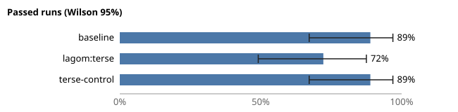

<!-- generated by bench/report.py from bench/testdata/sample-runs.jsonl (baseline baseline, 2000 resamples, seed 1); edit the results, not this page -->
# Benchmarks

Every arm is shown, including the ones that lose. Cost per passed task, pass rate and turns are separate numbers, never one score. Ratios below 1 mean the arm used less than the baseline; the intervals are 95%. How the numbers are made, and how to rerun them: [Benchmark methodology](benchmark-methodology.md).

| arm | passed (95%) | cost per passed task | turns (median) | cost ÷ baseline (95%) | turns ÷ baseline (95%) |
|---|---|---:|---:|---|---|
| baseline | 16/18 (67%–97%) | $0.1535 | 10 | (baseline) | (baseline) |
| lagom:terse | 13/18 (49%–88%) | $0.1466 | 8 | 0.81 (0.77–0.85) | 0.84 (0.73–0.98) |
| terse-control | 16/18 (67%–97%) | $0.1426 | 9 | 0.92 (0.89–0.94) | 0.93 (0.80–1.08) |

Agent fake, sign-in fake, model the agent's default. 54 runs of 6 tasks under 3 arms, compared with `baseline`.
- `lagom:terse` ran lagom 0.1.1.

## Per arm

| arm | passed (95%) | timeouts | median s | median API s | s to a pass | cost per pass | turns | tool calls | tool output share | Bash rewritten | exercised | risky tasks with a test |
|---|---|---:|---:|---:|---:|---:|---:|---:|---:|---:|---:|---:|
| baseline | 16/18 (67%–97%) | 0 | 43.4 | 34.5 | 43.2 | 0.1535 | 10 | 7 | 7% | – | – | 0/6 |
| lagom:terse | 13/18 (49%–88%) | 1 | 42.3 | 31.0 | 41.2 | 0.1466 | 8 | 7 | 4% | 58% | 100% | 4/6 |
| terse-control | 16/18 (67%–97%) | 0 | 44.4 | 32.3 | 44.4 | 0.1426 | 9 | 7.5 | 5% | – | – | 3/6 |

Tool calls by type: baseline: Bash 47, Edit 18, Read 71; lagom:terse: Bash 43, Edit 17, Read 64; terse-control: Bash 44, Edit 18, Read 76

## Against the baseline

Geometric mean over tasks of the arm-to-baseline ratio of per-task medians; below 1 means the arm used less. 95% intervals from a paired bootstrap over tasks (2000 resamples, seed 1).

**cost** (`cost_usd`)

| arm | ratio | 95% interval | tasks | below/above | sign p |
|---|---:|---|---:|---:|---:|
| lagom:terse | 0.808 | 0.775–0.851 | 6 | 6/0 | 0.031 |
| terse-control | 0.918 | 0.891–0.945 | 6 | 6/0 | 0.031 |

**wall time** (`wall_ms`)

| arm | ratio | 95% interval | tasks | below/above | sign p |
|---|---:|---|---:|---:|---:|
| lagom:terse | 0.981 | 0.947–1.018 | 6 | 4/2 | 0.688 |
| terse-control | 1.021 | 0.983–1.058 | 6 | 2/4 | 0.688 |

**API time** (`api_ms`)

| arm | ratio | 95% interval | tasks | below/above | sign p |
|---|---:|---|---:|---:|---:|
| lagom:terse | 0.897 | 0.875–0.921 | 6 | 6/0 | 0.031 |
| terse-control | 0.954 | 0.926–0.986 | 6 | 5/1 | 0.219 |

**turns** (`turns`)

| arm | ratio | 95% interval | tasks | below/above | sign p |
|---|---:|---|---:|---:|---:|
| lagom:terse | 0.844 | 0.735–0.980 | 6 | 4/1 | 0.375 |
| terse-control | 0.929 | 0.798–1.082 | 6 | 2/2 | 1.000 |

**tool calls** (`tool_calls`)

| arm | ratio | 95% interval | tasks | below/above | sign p |
|---|---:|---|---:|---:|---:|
| lagom:terse | 1.043 | 0.956–1.159 | 6 | 1/2 | 1.000 |
| terse-control | 1.087 | 0.978–1.186 | 6 | 1/4 | 0.375 |

**output tokens** (`usage.output`)

| arm | ratio | 95% interval | tasks | below/above | sign p |
|---|---:|---|---:|---:|---:|
| lagom:terse | 0.900 | 0.900–0.900 | 6 | 6/0 | 0.031 |
| terse-control | 0.950 | 0.950–0.950 | 6 | 6/0 | 0.031 |

**uncached input tokens** (`usage.input`)

| arm | ratio | 95% interval | tasks | below/above | sign p |
|---|---:|---|---:|---:|---:|
| lagom:terse | 1.421 | 0.638–3.304 | 6 | 2/4 | 0.688 |
| terse-control | 0.953 | 0.411–2.758 | 6 | 4/2 | 0.688 |

## Per task

Passed runs, median seconds and median cost per arm, by kind of task, so losses show.

### build

| task | baseline | lagom:terse | terse-control |
|---|---|---|---|
| python/retry-decorator | 3/3, 49.5 s, 0.1552 | 2/3, 46.2 s, 0.1227 | 2/3, 47.0 s, 0.1448 |

### feature

| task | baseline | lagom:terse | terse-control |
|---|---|---|---|
| rust/cli-flag | 2/3, 43.6 s, 0.0821 | 2/3, 46.1 s, 0.0748 | 3/3, 46.2 s, 0.0753 |

### prose

| task | baseline | lagom:terse | terse-control |
|---|---|---|---|
| prose/review-sql | 3/3, 42.9 s, 0.2212 | 1/3, 43.9 s, 0.1684 | 3/3, 42.1 s, 0.2148 |

### small-fix

| task | baseline | lagom:terse | terse-control |
|---|---|---|---|
| output-heavy/log-needle | 3/3, 42.1 s, 0.1753 | 3/3, 41.2 s, 0.1460 | 3/3, 44.3 s, 0.1630 |
| python/deep-merge | 3/3, 43.7 s, 0.1277 | 2/3, 42.3 s, 0.1011 | 2/3, 44.0 s, 0.1141 |
| rust/off-by-one | 2/3, 43.8 s, 0.0549 | 3/3, 40.8 s, 0.0422 | 3/3, 47.4 s, 0.0475 |

## How runs are counted

- Every run counts for the pass rate. A run that timed out, crashed or printed output that didn't parse counts as failed.
- A timed-out run's time is the time until it was stopped. It reports no cost, so it is left out of cost medians and cost per pass, and counted in the timeouts column.
- Rate-limited attempts are retried and not counted; the throwaway warm-up call isn't counted.
- Tool output share: bytes of tool results ÷ 4, over all input tokens (uncached, cache reads and writes).
- Bash rewritten: commands Lagom ran through `lagom run` ÷ Bash calls, for Lagom arms.
- Exercised: the share of an arm's runs in which Lagom injected its style or ran a command. Under two thirds, the arm's comparisons don't count.
- Risky tasks with a test: runs of tasks marked `risky` before the run in which the agent added or changed a test.

## Limitations

- Medians and ratios cover the tasks in this run only; with few tasks, intervals are wide.
- A fake agent produced these runs: they test the harness, not any agent or style.
- Tool output tokens are estimated from bytes; input tokens come from `modelUsage`, which counts subagents.
- Tasks are small and synthetic; real repositories differ.
